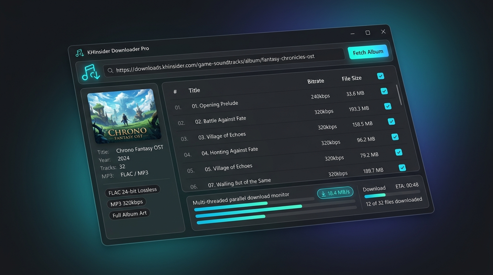
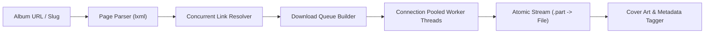

<div align="center">


# KHInsider Downloader Pro

**A modern, high-speed desktop downloader and CLI tool for video game soundtracks**

*Download complete OSTs, lossless FLAC, high-res artwork & booklet scans, and automated metadata tags with ease.*

<p>
  
  
  
  
  
  
</p>

---

<p>
  <a href="#-about-khinsider-downloader-pro">About</a> •
  <a href="#-key-features">Features</a> •
  <a href="#-visual-tour--workflow">Visual Tour</a> •
  <a href="#-folder-organization">Organization</a> •
  <a href="#-installation--getting-started">Installation</a> •
  <a href="#-command-line-usage">CLI Usage</a> •
  <a href="#-architecture--performance">Performance</a> •
  <a href="#-building-from-source">Building</a> •
  <a href="#-icon--design-philosophy">Design</a> •
  <a href="#-license--disclaimer">License</a>
</p>

<picture>
  
</picture>

</div>

---

## 🎵 About KHInsider Downloader Pro

[KHInsider](https://downloads.khinsider.com) hosts one of the world's most comprehensive archives of video game music, from retro chiptunes to modern orchestral scores. However, manually saving multi-disc albums, booklet scans, and high-fidelity tracks one-by-one is tedious and slow.

**KHInsider Downloader Pro** delivers a streamlined, blazing-fast experience for collectors and audiophiles alike:

- 🎯 **Targeted Extraction**: Choose precisely what formats you want (FLAC, MP3, OGG, M4A) with live size and track calculations before downloading.
- ⚡ **Multi-Threaded Engine**: Concurrent link resolution and parallel chunked downloads maximize your bandwidth.
- 🖼️ **Full-Resolution Artwork**: Fetches uncapped cover art, multi-page booklet scans, disc prints, and obi strips directly from original CDN links.
- 🏷️ **Audiophile Tagging**: Automatically embeds front covers into ID3 (MP3) and Vorbis picture blocks (FLAC) and generates ready-to-play `.m3u` playlists.
- 🪟 **Dual Interface**: Enjoy a sleek, dark PyQt6 desktop interface or run headless from PowerShell and scripts.

---

## ✨ Key Features

<table>
  <tr>
    <td width="50%">
      <h3>🎛️ Per-Format Granularity</h3>
      <p>Every available format gets its own toggle card showing track count and total payload size. Select FLAC only, MP3 only, or any custom combination.</p>
    </td>
    <td width="50%">
      <h3>📁 Clean Subfolder Hierarchy</h3>
      <p>Multi-format downloads are automatically sorted into dedicated subdirectories (<code>FLAC/</code>, <code>MP3/</code>, <code>Artwork/</code>) to keep your library pristine.</p>
    </td>
  </tr>
  <tr>
    <td width="50%">
      <h3>⚡ Parallel Transfer Engine</h3>
      <p>Download tracks concurrently across 1–16 worker threads with HTTP connection pooling, keep-alive sessions, and automatic retry on rate limits.</p>
    </td>
    <td width="50%">
      <h3>🖼️ Lossless Artwork &amp; Scans</h3>
      <p>Bypasses web thumbnails to preserve pristine original images: front &amp; back covers, high-res CD prints, liner notes, and full multi-page booklets.</p>
    </td>
  </tr>
  <tr>
    <td width="50%">
      <h3>🏷️ Automatic Tagging &amp; Playlists</h3>
      <p>Embeds high-resolution cover art directly into audio files and compiles dedicated <code>.m3u</code> playlists for each format automatically.</p>
    </td>
    <td width="50%">
      <h3>⏯️ Resumable &amp; Zero-Request Skips</h3>
      <p>Interrupted downloads resume via HTTP Range headers. Already-downloaded tracks are verified locally and skipped with zero network overhead.</p>
    </td>
  </tr>
</table>

---

## 📸 Visual Tour & Workflow

<div align="center">
  
</div>

### 1. Album Fetcher & Command Bar
Paste any album URL or bare slug (e.g. `mafia-ii-official-orchestral-score`) into the top command bar and click **Fetch Album**. Metadata, platforms, release year, track counts, and available formats are parsed in a fraction of a second.

### 2. Format & Content Inspector (Left Panel)
- **Album Card**: High-res cover thumbnail, title, release year, and system platforms.
- **Content Cards**: Separate selectable cards for **FLAC**, **MP3**, **Artwork & Scans**, and **Extra Files** (CUE sheets, info text). Each card clearly displays track counts and calculated file sizes.
- **One-Click Presets**: Rapidly toggle presets: *All*, *Lossless only*, *MP3 only*, or *Artwork only*.
- **Output Preferences**: Change destination path, adjust concurrent thread count (1–16), and toggle subfolder organization.

### 3. Tracklist & Live Transfer Monitor (Right Panel)
- **Songlist Grid**: Searchable, granular tracklist with disc and track numbers, titles, and durations. Toggle individual tracks on or off.
- **Parallel Thread Monitor**: Watch each parallel worker thread in real-time with smooth progress bars, per-thread transfer rates, aggregate download speed, and dynamic time-to-completion (ETA).

---

## 📁 Folder Organization

When organizing by format is enabled (default), albums are cleanly structured on disk:

```
Mafia II Official Orchestral Score/
├── FLAC/                          ← Uncompressed lossless 16/24-bit audio
│   ├── 01 Main Theme.flac
│   ├── 02 Empire Bay.flac
│   └── ...
├── MP3/                           ← High-bitrate portable audio
│   ├── 01 Main Theme.mp3
│   ├── 02 Empire Bay.mp3
│   └── ...
├── Artwork/                       ← Full-resolution covers, booklets, disc scans
│   ├── Front Cover.jpg
│   ├── Back Cover.jpg
│   └── Booklet Page 01.jpg
├── Mafia II ... [FLAC].m3u        ← Playlist for lossless files
├── Mafia II ... [MP3].m3u         ← Playlist for MP3 files
└── khinsider.info.txt             ← Original KHInsider album details
```

> **Tip**: Use `--no-organize` in CLI or uncheck *Separate subfolder per format* in the GUI to output files flat into a single folder.

---

## 🚀 Installation & Getting Started

### 1. Pre-Built Standalone Executable (No Python Required)

Run the portable Windows application directly:

```powershell
dist\KHInsiderDownloader.exe
```

You can also pass arguments from PowerShell or Windows Terminal:

```powershell
.\dist\KHInsiderDownloader.exe "mafia-ii-official-orchestral-score"
```

### 2. Running from Source

**Prerequisites:** Python 3.10+ installed on your system.

1. **Clone the repository:**
   ```powershell
   git clone https://github.com/projectGloria/KHInsiderDownloader.git
   cd KHInsiderDownloader
   ```

2. **Install required dependencies:**
   ```powershell
   pip install -r requirements.txt
   ```

3. **Launch the Desktop GUI:**
   ```powershell
   python khinsider_downloader.py
   ```
   *(or run `python khinsider_gui.py` directly)*

---

## 💻 Command Line Usage

KHInsider Downloader Pro includes a rich, scriptable CLI for automation and headless environments.

```powershell
# Download full album (all formats + artwork + extras)
python khinsider_downloader.py mafia-ii-official-orchestral-score

# Download only lossless FLAC audio + artwork into FLAC/
python khinsider_downloader.py <album_url> --formats flac

# Download FLAC and MP3 side-by-side in separate subfolders
python khinsider_downloader.py <album_url> --formats flac,mp3

# Use presets instead of specifying individual formats
python khinsider_downloader.py <album_url> --format lossless
python khinsider_downloader.py <album_url> --format art_only

# High-bandwidth mode: 12 parallel connections into a custom music directory
python khinsider_downloader.py <album_url> --formats flac -w 12 -o "D:/Music/Soundtracks"
```

> **Note**: A bare album slug works everywhere a full KHInsider URL does.

### CLI Options Reference

| Flag | Argument | Description |
| :--- | :--- | :--- |
| `--formats` | `LIST` | Explicit comma-separated formats (e.g. `flac` or `flac,mp3`). Overrides `--format`. |
| `-f, --format` | `PRESET` | Preset: `all`, `lossless`, `mp3`, `art_only` *(default: `all`)*. |
| `-o, --output` | `PATH` | Custom target directory *(default: `./downloads`)*. |
| `-w, --workers` | `INT` | Number of concurrent download worker threads *(default: 6, range: 1–16)*. |
| `--no-artwork` | — | Skip downloading covers and booklet scans. |
| `--no-extras` | — | Skip extra files (cue sheets, info text files). |
| `--no-organize` | — | Output all files into the album root without format subfolders. |
| `--no-tag` | — | Disable embedding front cover art into audio tags. |
| `--no-playlist`| — | Disable `.m3u` playlist generation. |
| `--gui` | — | Force the graphical interface even when arguments are passed. |

---

## ⚡ Architecture & Performance

The engine is engineered around throughput, resilience, and data integrity:



- **Two-Fetch Concurrent Resolution**: Album pages only contain link pages. CDN download targets are resolved in parallel before starting transfers.
- **Connection Pooling & HTTP Keep-Alive**: Reuses single TLS sessions across all requests to eliminate SSL handshake overhead, with automatic exponential backoff on HTTP 429/5xx errors.
- **Atomic File Integrity**: Files stream to `.part` buffers and atomically swap to final paths only when complete.
- **Instant Re-Runs**: Completed tracks are recognized immediately; repeat runs skip existing files with **zero** network requests.
- **Resumable Transfers**: Interrupted or paused downloads pick up exactly where they stopped using HTTP `Range` requests.
- **In-Memory Tagging Cache**: Cover artwork bytes are cached per directory, embedding artwork into FLAC/MP3 files in milliseconds without redundant disk reads.

---

## 🛠️ Building from Source

Package KHInsider Downloader Pro into a single, portable Windows executable:

```powershell
python -m PyInstaller KHInsiderDownloader.spec --clean
```

The optimized, standalone executable will be written to:
```
dist/KHInsiderDownloader.exe
```

---

## 🎨 Icon & Design Philosophy

<p align="center">
  
</p>

> *"A vibrant neon cyan and violet musical disc emblem engineered for dark interfaces and high legibility."*

- **Dark Theme Aesthetics**: Built with deep charcoal tones (`#12151c`), subtle glass borders, and high-contrast typography designed for long listening sessions.
- **Taskbar & High-DPI Clarity**: Multi-resolution icon structure (16px to 256px) remains crisp across 4K displays and Windows taskbar scales.

---

## 📜 License & Disclaimer

- **License**: Distributed under the **MIT License**.
- **Disclaimer**: This tool is an independent client and is not officially affiliated with or endorsed by KHInsider. All video game soundtracks, covers, and trademarks belong to their respective developers, publishers, and composers. Please support game composers by purchasing official soundtrack releases.
